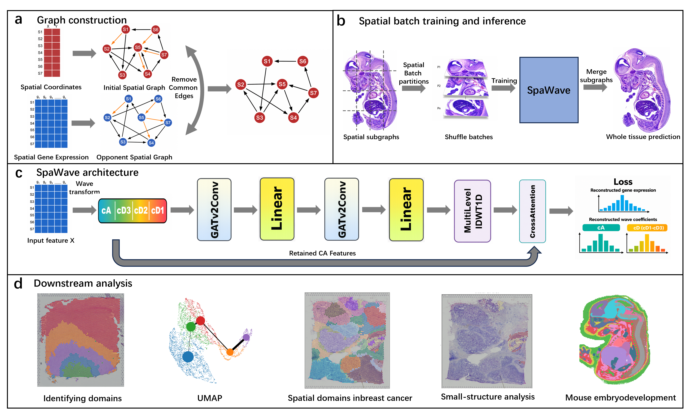

<div align="center">
  <h1 align="center">SpaWave: Wavelet-enhanced Graph Learning for Spatial Domain Identification in Spatial Transcriptomics</h1>

  

  <br/>

</div>

<br/>


## 📖 Introduction

With the rapid accumulation of spatial transcriptomics (ST) data, there is a growing need for accurate spatial domain identification in noisy and heterogeneous tissues. However, existing methods often rely on raw or smoothed expression profiles that are sensitive to dropout events and technical noise, and spatial graphs built solely from physical proximity may contain unreliable edges across biological boundaries. In this study, we present SpaWave, a wavelet-domain graph attention method for spatial domain identification. SpaWave combines expression-dissimilarity-guided spatial graph refinement, multi-scale wavelet transformation, and graph attention learning to learn robust spot embeddings. Benchmarking across four SRT datasets shows that SpaWave achieves competitive or superior performance compared with representative methods. SpaWave also identifies expression-associated subregions in human breast cancer, captures major spatial compartments in developing human heart sections, and recovers marker-supported tissue structures in large-scale mouse embryo data.

---

## 💻 System Requirements

### Operating System
- 🐧 **Linux**: Ubuntu 24.04.1 | NVIDIA GeForce RTX 3090 GPU

### Software Prerequisites
- 🐍 **Python**: `>= 3.9` *(Tested successfully on Python 3.9.19)*
- 🟩 **CUDA**: `11.8` *(For Linux GPU acceleration)*

---

## ⚙️ Installation Guide

Follow these sequential steps to set up `SpaWave` in your environment.

### 1️⃣ Clone the Repository
```bash
git clone https://github.com/bxf293/SpaWave.git
cd SpaWave
```

### 2️⃣ Create a Virtual Environment
We recommend using Conda to cleanly manage your dependencies.
```bash
conda create -n spawave python=3.9 r-base=4.4.2 r-mclust -c conda-forge -y
conda activate spawave
```

### 3️⃣ Install Core Dependencies
Install the required packages efficiently using the provided wheels:
```bash
# Install base requirements
pip install -r requirements.txt -i https://pypi.tuna.tsinghua.edu.cn/simple --extra-index-url https://download.pytorch.org/whl/cu118 -f https://data.pyg.org/whl/torch-2.2.0+cu118.html

# Install PyTorch Geometric extensions
pip install pyg_lib torch_scatter torch_sparse torch_cluster torch_spline_conv -f https://data.pyg.org/whl/torch-2.2.0+cu118.html
pip install torch_geometric
```

### 4️⃣ Install SpaWave
Finally, install `SpaWave` into your environment:
```bash
pip install .
```

---

## 💬 Contact & Support

If you encounter any issues, bugs, or have questions about the package, we are here to help!
- 🐛 **Issue Tracker**: Feel free to submit an issue on GitHub.
- 📧 **Email**: Reach out to us directly at [622240150052@cqjtu.edu.cn]
